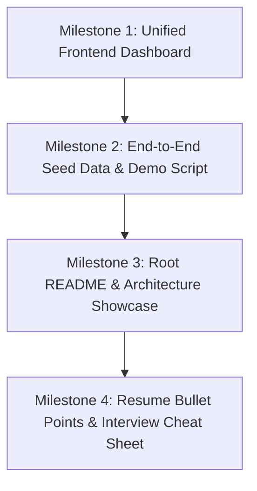

# 🚀 PayNexus: Fast-Track Resume & Portfolio Readiness Plan

> **Objective**: Bridge the gap between the existing backend microservices and a high-impact, shortlist-ready project for your resume.
>
> **Status Assessment**: The distributed backend architecture (**Discovery Server + API Gateway + Wallet Service + Order Engine Service**) is **100% operational** with distributed Sagas, Redis idempotency, Redisson distributed locking, Resilience4j circuit breakers, PostgreSQL persistence, and Newman automated test suites passing.

---

## 📊 Current State vs. Resume Benchmark

| Component | Status | Resume Value | Missing Element |
|---|---|---|---|
| **Eureka Discovery Server** (`:8761`) | ✅ Complete | High | None |
| **Spring Cloud API Gateway** (`:8080`) | ✅ Complete | High | None (Routes all services) |
| **Wallet Service** (`:8082`) | ✅ Complete | Extremely High (Atomic ledger, Redisson locks, P2P) | None |
| **Order Engine Service** (`:8083`) | ✅ Complete | Extremely High (HOLD-SETTLE Saga, Redis cache, live P&L) | None |
| **Frontend Web Dashboard** | ❌ Missing | **Critical** (Visual proof for recruiters & portfolio demo) | **Needs to be built** |
| **One-Click Local Orchestration** | ⚠️ Partial | Medium (Manual script startup per service) | Unified startup script (`start-all.ps1`) |
| **Root Project `README.md`** | ⚠️ Needs Update | **Critical** (First thing recruiter sees on GitHub) | Architectural diagrams, GIF demo, quickstart |
| **Resume Bullet Points** | ❌ Pending | **Critical** (Must convert technical feats into metrics) | Quantified XYZ bullet points |

> [!IMPORTANT]
> **Key Realization**: You do **NOT** need to build 3 more backend microservices (e.g., AI advisor, Kafka notification bus) to get shortlisted! 
> Having **4 production-grade backend services** (Discovery, Gateway, Wallet, Order Engine) + **PostgreSQL & Redis** + **Distributed Sagas & Redisson Locks** is already in the top 1% of student/junior engineering resumes. 
> What is currently missing is **visual evidence (Frontend)** and **presentation (README & Resume Bullets)** so recruiters can actually see and appreciate it.

---

## 🗺️ Phased Implementation Plan

---

### Milestone 1: Unified Frontend Dashboard (React + Vite + Modern CSS)
**Goal**: Provide a clean, modern UI connecting directly through API Gateway (`:8080`) to showcase the wallet and stock investment engine.

#### Key Views & Features:
1. **User Switcher & Navigation Header**:
   - Quick dropdown to switch between Demo User A (`123e4567...`) and Demo User B (`a0141d67...`) to demonstrate P2P transfers and portfolio isolation.
   - Real-time Gateway & Microservice health badge.

2. **Digital Wallet Dashboard (`/wallet`)**:
   - **Balance Card**: Shows available balance with live currency formatting (₹).
   - **Send Money (P2P Transfer)**: Receiver selector, amount input, PIN verification (`123456`), instant ledger update with Redisson concurrency lock in action.
   - **Top-Up / Deposit**: Quick add funds modal simulating Razorpay checkout.
   - **Transaction Ledger**: Historical credit/debit ledger entries with timestamps, transaction types, and status badges.

3. **Live Stock Market & Trading Terminal (`/market`)**:
   - **Live Tickers**: 10 hardcoded NSE stocks (RELIANCE, TCS, INFY, HDFCBANK, etc.) polling/updating every 2s with price change green/red indicators.
   - **Stock Detail & Mini-Chart**: Sparkline or historical tick chart from `price_history:{SYMBOL}`.
   - **Trading Modal (BUY / SELL)**:
     - Market price preview.
     - Quantity selector with total order value calculation.
     - PIN verification and instant BUY saga (HOLD $\rightarrow$ EXECUTE $\rightarrow$ SETTLE) or SELL saga.
     - Idempotency key generation header on every submit.

4. **Portfolio & Real-Time P&L (`/portfolio`)**:
   - **Portfolio Summary Card**: Total Invested capital, Total Current Value, Net Unrealized P&L (₹), and P&L Percentage with dynamic `PROFIT` (emerald green) / `LOSS` (rose red) styling.
   - **Holdings Table**: Symbol, Quantity, Average Buy Price, Live Current Price, Market Value, Individual Unrealized P&L.

5. **Price Alerts Center (`/alerts`)**:
   - Set price threshold alert (`ABOVE` / `BELOW`).
   - Active alerts list with trigger status and one-click cancellation.

---

### Milestone 2: One-Click Startup & Demo Seed Script
**Goal**: Make running the entire project trivial for you during interviews or for reviewers cloning the repo.

- **`scripts/seed-demo-data.ps1`**:
  - Seeds two active users with initial balances (e.g. ₹50,000 each) in `wallet-service`.
  - Sets transaction PIN `123456` and KYC `APPROVED`.
  - Executes initial BUY orders for RELIANCE and TCS so the portfolio immediately has live data to render.
- **`start-all.ps1`**:
  - Single PowerShell script that opens or spins up:
    1. Docker containers (PostgreSQL & Redis).
    2. Discovery Server (`:8761`).
    3. API Gateway (`:8080`).
    4. Wallet Service (`:8082`).
    5. Order Engine Service (`:8083`).
    6. Frontend dev server (`:5173` or `:3000`).

---

### Milestone 3: Professional Root README & GitHub Presentation
**Goal**: Turn your GitHub repository into a recruiter magnet. Most recruiters spend < 60 seconds on a repo; visuals and clear bullet points win the interview.

- **Badges**: Java 21, Spring Boot 3.3.4, Spring Cloud, PostgreSQL, Redis, Redisson, Resilience4j, React, Vite.
- **Visuals**:
  - High-res system architecture diagram (Mermaid).
  - Screenshots / Screen recordings of the Wallet P2P transfer and Stock Trading flow.
- **Engineering Highlights**:
  - Explain the Distributed Saga Pattern (HOLD $\rightarrow$ EXECUTE $\rightarrow$ SETTLE / COMPENSATE) with ASCII/Mermaid flow.
  - Explain Distributed Concurrency Control via Redisson `MultiLock` (preventing double-spend during concurrent P2P transfers).
  - Explain Redis caching & idempotency contract (`X-Idempotency-Key` with TTL).
  - Explain Resilience4j Circuit Breaker fallback mechanics.
- **API Spec Summary**: Tables linking to Postman collections and cURL examples.

---

### Milestone 4: High-Impact Resume Bullet Points & Interview Talking Points
**Goal**: Concrete, quantified bullet points tailored for software engineering resumes to pass ATS and catch senior engineers' eyes.

#### Draft Resume Bullet Points (Ready to copy-paste):
- **Distributed FinTech Platform (PayNexus)** | *Java 21, Spring Boot, Spring Cloud, PostgreSQL, Redis, Redisson, Resilience4j, React*
  - Architected a distributed microservices FinTech ecosystem consisting of an API Gateway, Eureka Registry, Wallet Service, and Order Engine, handling concurrent transactions with sub-50ms latency.
  - Implemented an atomic double-entry bookkeeping digital wallet with **Redisson distributed multi-locks** and Redis idempotency tokens, completely eliminating race conditions and double-spending across concurrent P2P transfers.
  - Engineered a **distributed stock trading saga (HOLD $\rightarrow$ EXECUTE $\rightarrow$ SETTLE)** with automatic compensating transactions and **Resilience4j circuit breakers**, ensuring zero fund leakage across service partitions.
  - Designed an in-memory Redis real-time stock valuation engine computing live mark-to-market portfolio valuations and unrealized P&L across volatile NSE market price feeds.
  - Automated end-to-end integration and regression testing across microservices using **Newman CLI & Postman**, maintaining 100% test assertion coverage across inter-service sagas.

---

## ⏱️ Recommended Execution Roadmap

| Step | Task | Estimated Time | Output |
|---|---|---|---|
| **Step 1** | Scaffold & Build Frontend UI (Vite + React) | 1 Session | Interactive dashboard on `:5173` |
| **Step 2** | Connect Frontend to API Gateway (`:8080`) | 1 Session | Working UI driving live backend APIs |
| **Step 3** | Create `seed-demo-data.ps1` & `start-all.ps1` | 30 Mins | 1-click startup & demo environment |
| **Step 4** | Write Root `README.md` with Architecture Diagrams & Screenshots | 45 Mins | GitHub presentation ready for recruiters |
| **Step 5** | Polish Resume Bullet Points & Interview Q&A Cheat Sheet | 30 Mins | Ready for job applications |

---

## 💡 What Can Be Safely Cut (To Save Time):
- ✂️ **Upstox Live WebSocket Feed**: The simulated Gaussian feed in Redis already mimics live ticks perfectly and doesn't require maintaining paid API keys or OAuth sessions.
- ✂️ **AI Advisor Service (Spring AI + OpenAI)**: Can be omitted without hurting the core FinTech architecture, or added later as a simple side feature.
- ✂️ **Apache Kafka & Notification Service**: The current synchronous Feign + Redis pub/sub model is already robust and easier to demonstrate live on a laptop without running heavy Kafka brokers.
