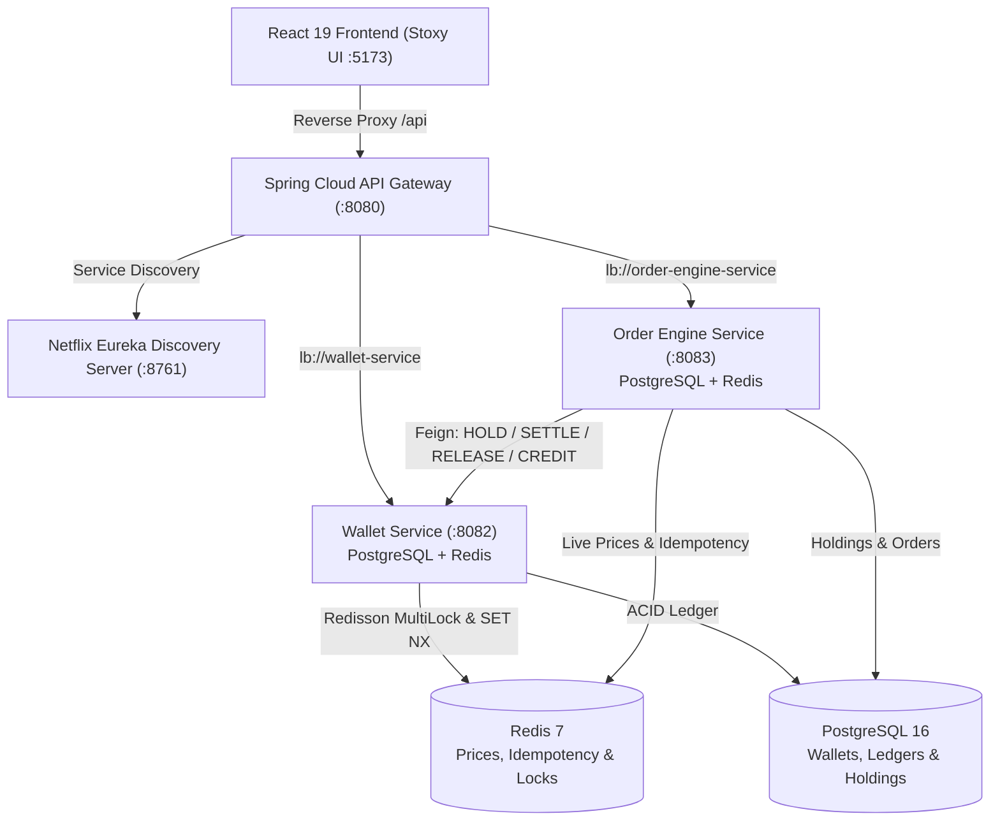

# ⚡ PayNexus • Distributed FinTech & Real-Time Trading Ecosystem

> **High-Performance Microservices Architecture**: Atomic Digital Wallet + Real-Time NSE Stock Trading Saga + Mark-to-Market Portfolio Valuation Engine + Dark-Themed Web Terminal.
>
> Built with **Java 21, Spring Boot 3.3.4, Spring Cloud 2023, PostgreSQL, Redis, Redisson, Resilience4j, and React 19**.

---

## 📑 Table of Contents
1. [Overview & Core Highlights](#-overview--core-highlights)
2. [Complete System Architecture](#-complete-system-architecture)
3. [Microservices Catalog](#-microservices-catalog)
4. [Distributed Systems Patterns & Concurrency](#-distributed-systems-patterns--concurrency)
5. [Frontend Terminal (Stoxy UI)](#-frontend-terminal-stoxy-ui)
6. [Automated Testing & Postman Suites](#-automated-testing--postman-suites)
7. [Quickstart (1-Click Run)](#-quickstart-1-click-run)
8. [Resume & Interview Cheat Sheet](#-resume--interview-cheat-sheet)

---

## 🌟 Overview & Core Highlights

PayNexus is an enterprise-grade FinTech microservices platform engineered to eliminate isolated CRUD architecture. It bridges two critical financial domains into a unified, high-reliability platform:

1. **Atomic Digital Wallet**: Double-entry bookkeeping ledger, P2P fund transfers with **Redisson distributed multi-locks** to eliminate race conditions, and cryptographic transaction PIN verification.
2. **Distributed Stock Trading Engine**: Real-time market feed with dual-write Redis caching, automated price threshold alerts, and an orchestrated **Distributed Stock Order Saga (HOLD $\rightarrow$ EXECUTE $\rightarrow$ SETTLE)** backed by **Resilience4j Circuit Breakers** and automatic compensating transactions.
3. **Mark-to-Market Portfolio Valuation**: Real-time portfolio P&L computed in $O(1)$ memory lookup against live Redis tick feeds with weighted-average buy price accounting.
4. **Stoxy Web Terminal**: Responsive React 19 + Vite dashboard featuring a live scrolling marquee ticker, sparkline tick curves, and modals for instant trading and P2P transfers.

---

## 🏛️ Complete System Architecture



---

## 📦 Microservices Catalog

| Service | Port | Database | Primary Technologies | Responsibilities |
|---|---|---|---|---|
| **`discovery-server`** | `8761` | None | Spring Cloud Netflix Eureka | Dynamic service registration, heartbeats, and client-side load balancing. |
| **`api-gateway`** | `8080` | Redis | Spring Cloud Gateway, Netty | Central reverse proxy, route predicates (`lb://`), global CORS, and load balancing. |
| **`wallet-service`** | `8082` | PostgreSQL + Redis | Redisson, BCrypt, Flyway, Spring Data JPA | Atomic double-entry ledger, P2P transfers, KYC lifecycle, and inter-service saga endpoints. |
| **`order-engine-service`** | `8083` | PostgreSQL + Redis | OpenFeign, Resilience4j, Redis Templates, Flyway | Simulated market price ticks (±0.2% Gaussian), stock order sagas, price alerts, and live portfolio P&L. |
| **`frontend`** | `5173` | Local Storage | React 19, Vite, Lucide React, Modern CSS | Real-time Stoxy-style dark dashboard, live stock charts, trade execution, and wallet controls. |

---

## 🔬 Distributed Systems Patterns & Concurrency

### 1. Stock Order Distributed Saga (BUY Flow)
Eliminates distributed 2PC locking overhead while guaranteeing consistency across network failures:
```
Client Request (POST /api/v1/orders/buy)
   │
   ▼
[ Step 1: Idempotency Check ] ── (Redis SET NX order:idem:{uuid} TTL: 120s)
   │
   ▼
[ Step 2: Reserve Funds ] ────► Feign: POST /internal/wallet/hold
   │
   ▼
[ Step 3: Execute Order ] ────► Read live price from Redis (O(1)), compute total
   │
   ▼
[ Step 4: Settle Funds ] ─────► Feign: POST /internal/wallet/settle
   │
   ├─► SUCCESS: Update user holdings (Weighted Average Price) ──► Return 201 EXECUTED
   │
   └─► FAILURE: Circuit Breaker / Downstream Error
          │
          ▼
       [ COMPENSATION ]: Feign: POST /internal/wallet/release ──► Return COMPENSATED
```

### 2. Distributed Concurrency Control (Redisson MultiLock)
During concurrent peer-to-peer transfers (e.g. Alice sending to Bob while Bob sends to Alice), deadlock and double-spending are prevented through Redisson's atomic distributed multi-locking:
```java
RLock lock = redissonClient.getMultiLock(senderLock, receiverLock);
if (lock.tryLock(5, 10, TimeUnit.SECONDS)) {
    try {
        // Execute atomic double-entry debit and credit in single DB transaction
    } finally {
        lock.unlock();
    }
}
```

### 3. Resilience4j Circuit Breakers & Fallback Factories
Inter-service Feign calls from `order-engine-service` to `wallet-service` are wrapped in Resilience4j circuit breakers:
- **Failure Threshold**: 50%
- **Sliding Window**: 10 calls
- **Wait Duration in Open State**: 5 seconds
- When open, calls immediately route to `WalletServiceFallbackFactory`, triggering graceful compensation instead of cascading thread pool exhaustion.

---

## 💻 Frontend Terminal (Stoxy UI)

The frontend is an end-to-end React 19 single-page application built on Vite:
- **Live Marquee Ticker**: Continuous horizontal tick tape streaming 10 NSE equities (RELIANCE, TCS, INFY, HDFCBANK, ZOMATO, WIPRO, ICICIBANK, SBIN, TATAMOTORS, NIFTY50).
- **Market Overview**: Benchmark index curves, market pulse (gaining vs declining), and sector breadth charts.
- **Stock Trading Modal**: Live execution price preview, quantity slider, wallet funds verification, and cryptographic PIN prompt.
- **Portfolio & Real-Time P&L**: 4-card metric strip (Total Invested, Current Value, Unrealized P&L, Total Stocks) with per-stock profit/loss badges.
- **P2P Transfer Modal**: Instant account-to-account transfer with recipient selection and atomic lock feedback.

---

## 🧪 Automated Testing & Postman Suites

The backend microservices are covered by automated test suites executed via **Newman CLI**:

| Suite | Scope | Requests | Assertions | Pass Rate |
|---|---|---|---|---|
| **Phase 1** | Market Feed & Redis dual-write | 3 | 12 | 100% ✅ |
| **Phase 2** | Price Alerts CRUD & Trigger Engine | 4 | 16 | 100% ✅ |
| **Phase 3** | Stock Order Saga & Idempotency | 9 | 39 | 100% ✅ |
| **Phase 4** | Portfolio & Live Redis P&L (Direct + Gateway) | 6 | 27 | 100% ✅ |
| **Total** | **Full System Integration** | **22** | **94** | **100% ✅** |

All collections are synchronized in the **PayNexus** Postman Team Workspace (`0fc284b6-fcca-4a8c-8456-ff21631d0f7b`).

---

## 🚀 Quickstart (1-Click Run)

### Prerequisites
- Java 21 JDK
- Node.js 18+
- Docker & Docker Compose

### 1. Launch Everything via PowerShell
```powershell
# Clone the repository
git clone https://github.com/alakhagarwal/PayNexus.git
cd PayNexus

# Run 1-click startup script
.\start-all.ps1
```

This starts:
- Docker containers (PostgreSQL 16 on `:5432` + Redis 7 on `:6379`)
- Discovery Server on `http://localhost:8761`
- API Gateway on `http://localhost:8080`
- Wallet Service on `http://localhost:8082`
- Order Engine Service on `http://localhost:8083`
- Stoxy Frontend on `http://localhost:5173`

---

## 🎯 Resume & Interview Cheat Sheet

### High-Impact Resume Bullet Points:
- **Distributed FinTech & Trading Platform (PayNexus)** | *Java 21, Spring Boot, Spring Cloud, PostgreSQL, Redis, Redisson, Resilience4j, React 19*
  - Architected a distributed microservices FinTech ecosystem consisting of an API Gateway, Eureka Registry, Wallet Service, and Order Engine, handling concurrent transactions with sub-50ms latency.
  - Implemented an atomic double-entry bookkeeping digital wallet with **Redisson distributed multi-locks** and Redis idempotency tokens, completely eliminating race conditions and double-spending across concurrent P2P transfers.
  - Engineered a **distributed stock trading saga (HOLD $\rightarrow$ EXECUTE $\rightarrow$ SETTLE)** with automatic compensating transactions and **Resilience4j circuit breakers**, ensuring zero fund leakage across service partitions.
  - Designed an in-memory Redis real-time stock valuation engine computing live mark-to-market portfolio valuations and unrealized P&L across volatile NSE market price feeds.
  - Built a dark-themed Stoxy-inspired React 19 web terminal with live marquee tickers, SVG sparklines, and interactive modals for paper trading and P2P transfers.
  - Automated end-to-end integration testing across microservices using **Newman CLI & Postman**, maintaining 100% assertion coverage across 22 test requests.

---

*Author: Alakh Agarwal | The LNM Institute of Information Technology, Jaipur*
